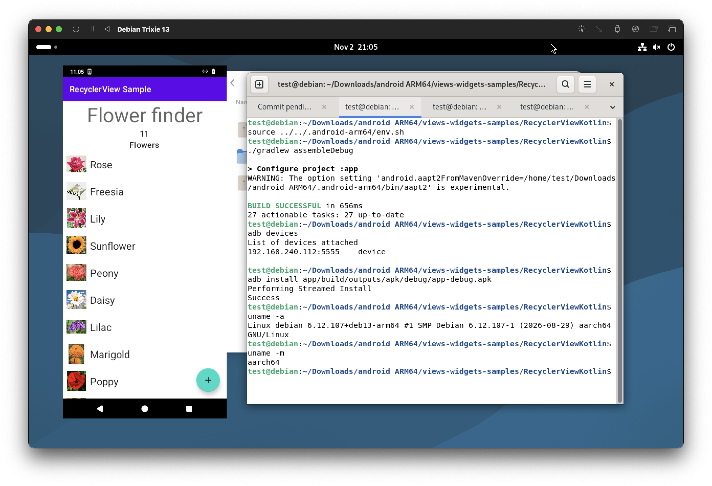

# Android Development Environment for Linux ARM64 (aarch64)

Set up a command-line Android development environment on a **Linux ARM64 host**.
This project brings together native Android tools, Java runtimes, SDK packages,
and optional Android runtimes so you can build, install, and debug Android apps
without an x86-64 development machine.



*Building and running a Kotlin Android app on Debian 13 (`aarch64`).*

Use it with Java and Kotlin Android projects through their Gradle wrapper.
Projects containing NDK C/C++ code additionally need a compatible NDK that runs
on the ARM64 host; **the installer does not currently provision an NDK**.
Android Studio is not required and is not installed.

## Supported hosts

| Distribution | Provisioning approach |
| --- | --- |
| Ubuntu on ARM64 | Installs native prerequisites and OpenJDK packages with `sudo apt-get`. Availability depends on the release's repositories. |
| Debian 13 on ARM64 | Downloads and extracts Android host tools into user-local storage; downloads managed Eclipse Temurin JDKs as needed. |
| Arch Linux / Arch Linux ARM | Installs native prerequisites with `sudo pacman -S --needed`; supplies additional Android tools from pinned, verified Debian ARM64 or architecture-independent packages in user-local storage. |

Run setup as your normal user. It requests `sudo` for system packages and
runtime services where needed. Internet access is required for downloads.
The installer selects distributions by `ID` in `/etc/os-release`; derivatives
are not automatically enabled through `ID_LIKE`. macOS and x86-64 Linux are
outside this installer's host support.

On Arch, update the system with `sudo pacman -Syu` before setup. The installer
does not refresh package databases or perform a full system upgrade. Full
installation and sample-build acceptance on Arch ARM64 remain pending; Debian
ARM64 is the development reference host.

## Quick start

Clone the repository and review the Android SDK license terms before passing
`--accept-licenses`:

```bash
git clone https://github.com/sonique6784/androiddev-for-linux-arm64-aarch64.git
cd androiddev-for-linux-arm64-aarch64
./setup-android-arm64.sh --accept-licenses
```

Then enter your Android project and load the generated environment in Bash:

```bash
cd /path/to/your/android-project
source "$HOME/.config/android-arm64/env.sh"
./gradlew assembleDebug
```

Source the environment in each new shell, from inside the project so its
Android Gradle Plugin declaration can be inspected for JDK selection. Use the
project's own `gradlew`; setup does not install a standalone Gradle distribution.
The wrapper downloads its configured Gradle version on first use.

For a conventional `app` module, the debug APK is usually at
`app/build/outputs/apk/debug/app-debug.apk`. Module names and build variants can
change that path.

## Tools and components

“Included” means provisioned or configured by setup, with the optional and
project-provided components identified below.

| Component | Purpose and availability |
| --- | --- |
| Android SDK platform | `platforms;android-30` is installed by default, including `android.jar`. |
| Android SDK build tools | `build-tools;29.0.2` is installed by default; key host executables are replaced with native ARM64 tools. |
| `sdkmanager` | Python-based SDK package manager supplied by the distribution or local package extraction. |
| `adb` | Connect to devices, install APKs, run shell commands, and read logs. Registered in the managed SDK's `platform-tools`. |
| `fastboot` | Android bootloader communication tool, also registered in `platform-tools`. |
| `aapt`, `aapt2` | Compile and package Android resources using native ARM64 executables. |
| `aidl` | Compile Android Interface Definition Language files. |
| `zipalign` | Align APK ZIP entries. |
| `apksigner` | Sign and verify APKs using Java. |
| `split-select` | Select APK splits for a device configuration. |
| JDK / `java` / `javac` | JDK 11 is the initial default; provisioning supports 11, 17, and 21. Ubuntu and Arch provision all three through system packages; Debian downloads managed JDKs on demand. |
| Gradle | Supplied by each Android project's Gradle wrapper (`./gradlew`). Setup configures its environment and native AAPT2 override. |
| Kotlin compiler and Android Gradle Plugin | Resolved by the project's Gradle configuration; no standalone Kotlin compiler is installed. |
| CMake, Ninja, Make, `pkg-config`, host C/C++ compilers | Installed as base prerequisites on Ubuntu and Arch. Debian's base setup does not provision these; its managed QEMU build installs build prerequisites when needed. These host tools do not constitute an Android NDK. |
| Python and download/archive utilities | Support SDK management, downloads, extraction, and AVD management. Exact prerequisites vary by distribution. |
| Waydroid | Optional Android container runtime, enabled with `--emulator waydroid`. |
| Android Emulator / Android QEMU | Optional, experimental AVD backend. Use a verified community ARM64 emulator package, a managed source build, or a compatible supplied binary. |
| Android NDK | Not provisioned. C/C++ Android builds require a separately supplied ARM64-host-compatible NDK. |

Setup installs a baseline SDK configuration, not every SDK platform or build
module a project may request. Check your project's `compileSdk`, build tools,
Gradle, plugin, and JDK requirements before building.

### Why native ARM64 tools matter

Android builds execute host programs as well as compile code for a target
device. An `arm64-v8a` device target does not make an x86-64 host executable run
on Linux ARM64.

Setup links native tools into build tools 29.0.2 and configures
`android.aapt2FromMavenOverride` to avoid Gradle downloading an x86-64 AAPT2
binary. Additional SDK build-tools versions are not automatically patched by
this installer; downloading a package alone does not establish ARM64 host
compatibility.

## Java, Kotlin, and NDK C/C++ projects

### Java and Kotlin

Both use the Android project's existing Gradle configuration:

```bash
cd /path/to/your/android-project
source "$HOME/.config/android-arm64/env.sh"
./gradlew assembleDebug
./gradlew test
apksigner verify --verbose app/build/outputs/apk/debug/app-debug.apk
```

When sourced, the environment looks for direct Android Gradle Plugin version
declarations in `.gradle` and `.gradle.kts` files. It selects JDK 17 for detected
plugin major versions 8 and above, and JDK 11 otherwise. This is a heuristic:
indirect declarations such as version catalogs may not be detected, and a
project may require a different JDK.

To explicitly provision and use one of the available JDK versions, run the
following from this repository, choosing 11, 17, or 21 to match your project:

```bash
jdk_home="$(./setup-android-arm64.sh --ensure-jdk 21 --skip-system-packages)"
cd /path/to/your/android-project
source "$HOME/.config/android-arm64/env.sh"
export JAVA_HOME="$jdk_home"
export PATH="$JAVA_HOME/bin:$PATH"
./gradlew -Dorg.gradle.java.home="$JAVA_HOME" assembleDebug
```

Run this after base setup. On Ubuntu and Arch, the selected JDK must already
be installed; Debian can download a missing managed JDK. The explicit Gradle
property overrides the generated JDK default. Project compatibility still
depends on its chosen Gradle and plugin versions.

### NDK C/C++ and JNI

Java or Kotlin apps can include native C/C++ libraries through their existing
Gradle `externalNativeBuild` configuration, using CMake or ndk-build. Before
building such a project:

- Supply an NDK with host executables that run on **Linux ARM64**, including its
  compiler and required build tools. An NDK targeting ARM64 Android devices
  alone is insufficient.
- Point the project at that NDK using its supported Android Gradle Plugin
  configuration and match the project's required NDK version.
- Provide ARM64-native CMake and Ninja when the project uses them, or the
  appropriate ndk-build tooling for its build configuration.

Then use the same `./gradlew assembleDebug` workflow. This repository does not
currently supply or validate an NDK toolchain, so NDK builds require additional
setup and are not a verified out-of-the-box capability.

## Run and debug apps

### Physical Android device

Enable USB debugging on the device, connect it, and accept its authorization
prompt. The host also needs permission to access the USB device.

```bash
adb devices
adb install -r /path/to/app-debug.apk
adb shell am start -n com.example.app/.MainActivity
adb logcat
```

Replace the APK path and activity with your app's values. If multiple devices
are connected, select one with `adb -s SERIAL`.

### Waydroid

Waydroid runs Android in a container and needs a compatible Linux kernel and a
Wayland desktop session. Enable it during setup:

```bash
./setup-android-arm64.sh --accept-licenses --emulator waydroid
source "$HOME/.config/android-arm64/env.sh"
android_arm64_emulator_show_ui
android_arm64_emulator_install /path/to/app-debug.apk
android_arm64_emulator_launch com.example.app
```

Accept the USB debugging prompt in the Waydroid window when connecting with
adb for the first time. Setup uses a GAPPS image by default;
`--waydroid-image vanilla` selects an image without Google apps.
`--waydroid-size 320x690` controls the window size, with density derived from
its width; `320x690` is the default.

Provisioning may enable Debian backports or add the official Waydroid
repository on Ubuntu when needed. Arch uses its configured repositories.
Waydroid packages, container services, and images require system-level changes.

After a reboot, load the environment and run:

```bash
android_arm64_emulator_start
android_arm64_emulator_show_ui
```

The session must start from a Wayland desktop. On GNOME, hold Super and drag
to move a window without a title bar.

### Android Virtual Devices (experimental)

The AVD tools can discover ARM64 system images, create devices, import an
existing AVD, and select the active device. **Boot, graphical output, adb
transport, and app-data persistence still require acceptance on Linux ARM64.**
AVD creation alone does not establish that an image will boot.

First install the base toolchain as shown above. To download and register the
community Linux AArch64 Android Emulator package:

```bash
./get-android-emulator-aarch64.sh
```

This fetches the latest release from the
[community emulator project](https://github.com/Changqing-JING/android-emulator-aarch64-linux/releases),
checks the published SHA-256, archive size and contents, and verifies that the
launcher and engine are Linux AArch64 binaries. This package is separate from
Google's SDK releases. Run the script again to check for a newer release.

List images, then create an AVD using an exact package ID from that output:

```bash
./setup-android-arm64.sh --avd-list-images
./setup-android-arm64.sh --avd-create My_Phone --avd-image 'PACKAGE_ID_FROM_LIST'
./setup-android-arm64.sh --avd-list
./setup-android-arm64.sh --avd-select My_Phone
./setup-android-arm64.sh --accept-licenses --emulator avd
source "$HOME/.config/android-arm64/env.sh"
```

Alternatively, `--avd-tui` opens the interactive creation picker.
`--avd-list-images --json` provides the catalog for scripts. Catalog and
creation commands do not require KVM or an emulator binary. Missing images are
downloaded from Google's catalog and checked against its size and checksum.
Creation refuses to overwrite an existing device name and selects the newest
created AVD. Stop the running AVD before switching devices.

Without a registered emulator package or supplied binary, AVD setup builds a
pinned Android QEMU engine from source. This can take substantial time and disk
space. KVM is used when accessible; otherwise the direct QEMU path uses TCG
software emulation. The direct QEMU path requires `userdata.img` to initialize
writable disks; images containing only a `data/` directory can be created but
are not bootable through that path.

Use `--avd-qemu-binary /absolute/path/to/qemu-system-aarch64` with AVD setup to
supply a compatible Linux ARM64 Android QEMU engine. It must provide the Android
Ranchu devices checked by the installer; a generic QEMU binary is insufficient.
Arch additionally needs a native `qemu-img`; setup reports if its package is
unavailable in the configured repositories.

To import an existing AVD, use
`--emulator avd --avd-ini /absolute/path/to/Device.ini`. Import stages a copy in
managed storage and leaves the original untouched. The importer currently
requires the supplied sample's userdata, encryption-key, and cache overlay
layout, plus its exact SDK image. See [AVD support and acceptance](AVD-support.md)
and [Android QEMU build reproduction](ANDROID-QEMU-BUILD-REPRO.md) for details.

### Runtime helpers

After emulator setup, source the environment to access these helpers for the
selected backend:

| Helper | Action |
| --- | --- |
| `android_arm64_emulator_start` | Start an already-provisioned runtime without invoking the package manager. |
| `android_arm64_emulator_stop` | Stop the runtime. |
| `android_arm64_emulator_status` | Report runtime or adb status. |
| `android_arm64_emulator_doctor` | Run backend diagnostics and applicable repairs. |
| `android_arm64_emulator_connect` | Establish or check the adb connection. |
| `android_arm64_emulator_install /path/to/app.apk` | Install or replace an APK. |
| `android_arm64_emulator_launch com.example.app` | Launch an app by package name. |
| `android_arm64_emulator_logcat` | Read Android logs. |
| `android_arm64_emulator_show_ui` | Open the Waydroid window; Waydroid only. |

## Configuration and storage

The default managed state directory is `~/.local/share/android-arm64/`:

| Path within managed state | Contents |
| --- | --- |
| `sdk/` | SDK platforms, build tools, and registered platform tools. |
| `bin/` | Native tool links and wrappers. |
| `jdks/` | Managed Debian JDK downloads and installations. Ubuntu and Arch use system JDK locations. |
| `host/` | User-local Android host packages and extractions on Debian and Arch. |
| `gradle/` | Gradle user home, caches, and generated properties. |
| `avd/` | Managed AVDs, runtime registration, logs, and emulator installations. |
| `cache/` | Managed QEMU source/build data and verified emulator or image archives. |
| `env.sh` | Generated environment loaded by `~/.config/android-arm64/env.sh`. |

The environment exports `ANDROID_HOME`, `ANDROID_SDK_ROOT`, `JAVA_HOME`,
`GRADLE_USER_HOME`, `GRADLE_OPTS`, and the tool `PATH`. Backend-specific library
or Python paths are configured where needed. Loading it uses the managed
Gradle user home rather than the shell's previous Gradle user home.

Useful setup options:

| Option | Behavior |
| --- | --- |
| `--accept-licenses` | Explicitly authorize Android SDK license acceptance. Required for normal SDK setup. |
| `--sdk-root /absolute/path` | Choose another SDK directory. Later AVD actions reuse their saved SDK root unless overridden. |
| `--skip-system-packages` | Use existing host prerequisites and cached local toolsets; does not provision missing host packages. SDK/image downloads and license requirements still apply. |
| `--ensure-jdk 11\|17\|21` | Provision or verify a JDK and print its home directory. |
| `--emulator none\|waydroid\|avd` | Choose optional runtime setup; default is `none`. |
| `--emulator-start waydroid\|avd` | Start an already-provisioned runtime. |
| `--emulator-doctor waydroid\|avd` | Diagnose an already-provisioned runtime. |
| `--help` | Print the full command reference. |

Setup is designed to be rerun. A normal run regenerates its environment and
Gradle properties, so keep project-specific settings in your project rather
than editing generated files. Previously configured runtime helpers are
retained when rerunning without `--emulator`.

Set `ANDROID_ARM64_STATE_ROOT=/absolute/path` consistently to relocate managed
state. The SDK default is independently fixed at
`~/.local/share/android-arm64/sdk`; pass `--sdk-root` as well to relocate it.
The community emulator downloader also accepts `--state-root /absolute/path`.
Waydroid maintains its own system and user data outside managed state.

## Troubleshooting

- **Tools missing from the shell:** source
  `~/.config/android-arm64/env.sh` in Bash after setup. Re-source from inside
  the project when relying on automatic JDK selection.
- **Java or Gradle compatibility errors:** check the project's required JDK,
  Gradle wrapper, and Android Gradle Plugin versions. Use explicit JDK selection
  as shown above when automatic detection is insufficient.
- **Executable format errors or AAPT2 failures:** check the host architecture
  of the failing binary. Preserve the generated AAPT2 override and remember
  that extra SDK/NDK packages may contain incompatible host tools.
- **Missing SDK platform:** compare the project's SDK requirements with the
  installed API 30 baseline. Extra packages need separate installation and
  host-tool compatibility checks.
- **Waydroid starts but never connects:** run
  `android_arm64_emulator_doctor`. It checks for known graphics failures and
  can apply Waydroid's software-rendering settings when that failure is found.
  Ensure the session runs on a Wayland desktop and accept adb authorization in
  the window.
- **AVD fails to start:** run `android_arm64_emulator_doctor` and inspect
  `~/.local/share/android-arm64/avd/emulator.log` (or the equivalent custom
  state path). Check the image, native engine, and KVM access. AVD boot remains
  experimental; image discovery or creation success does not guarantee boot.
- **Arch cached package verification fails:** follow the error naming the
  corrupt archive, then rerun normal setup. Downloads are checksum-verified and
  incomplete extractions are not activated.

## Optional example: build a Kotlin app

The original RecyclerView example remains useful as a small build exercise.
It is an external sample, not the purpose of this repository:

```bash
git clone --depth 1 --filter=blob:none --sparse https://github.com/android/views-widgets-samples.git views-widgets-samples
git -C views-widgets-samples sparse-checkout set RecyclerViewKotlin
sed -i 's/jcenter()/mavenCentral()/g' views-widgets-samples/RecyclerViewKotlin/build.gradle
cd views-widgets-samples/RecyclerViewKotlin
source "$HOME/.config/android-arm64/env.sh"
./gradlew :app:assembleDebug
apksigner verify --verbose app/build/outputs/apk/debug/app-debug.apk
```

The repository's baseline SDK packages were selected for this older sample,
which uses Gradle 6.5 and Android Gradle Plugin 4.1.0. Its repository replacement
moves dependency lookup from `jcenter()` to `mavenCentral()`.

## Contributing

Report installer problems or propose changes in
[this repository](https://github.com/sonique6784/androiddev-for-linux-arm64-aarch64/issues).
Include your distribution, host architecture, command, and relevant output.

The public installer is `setup-android-arm64.sh`. Distribution modules live in
`lib/android-arm64/platforms/`; optional runtime modules live in
`lib/android-arm64/emulators/`. New backends implement the shared contract
rather than adding another public installer.

For implementation changes, the existing backend checks are:

```bash
bash tests/backend-contract.sh
python3 tests/arch-backend.py
```

These checks do not replace a real Linux ARM64 installation, build, or emulator
boot acceptance test.
